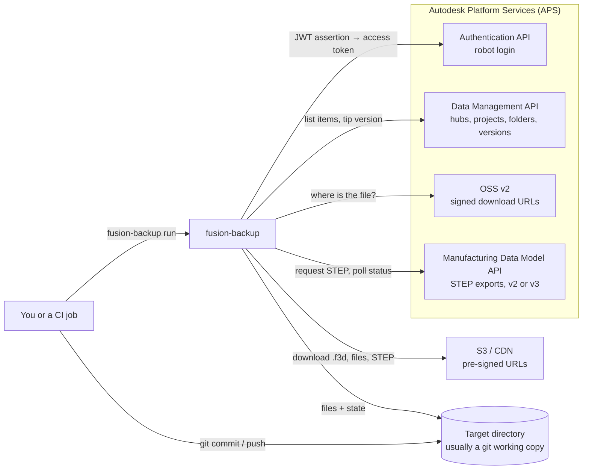
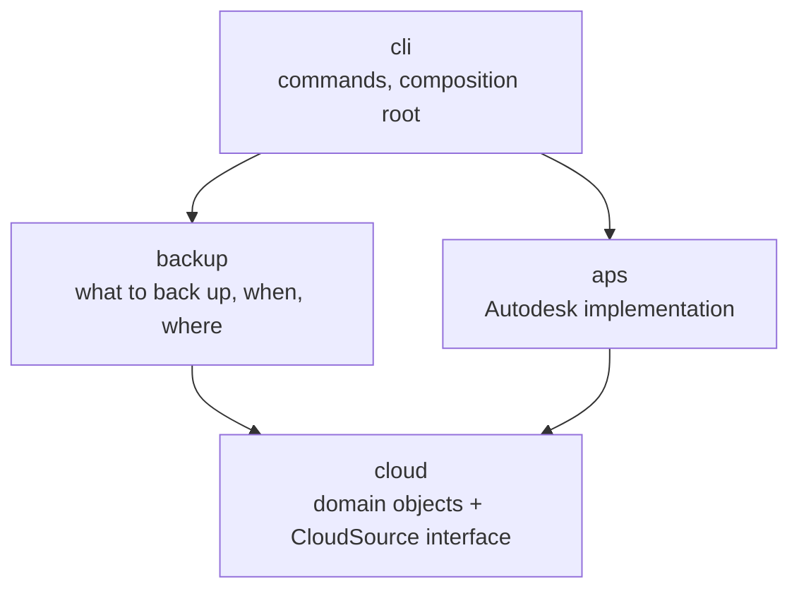
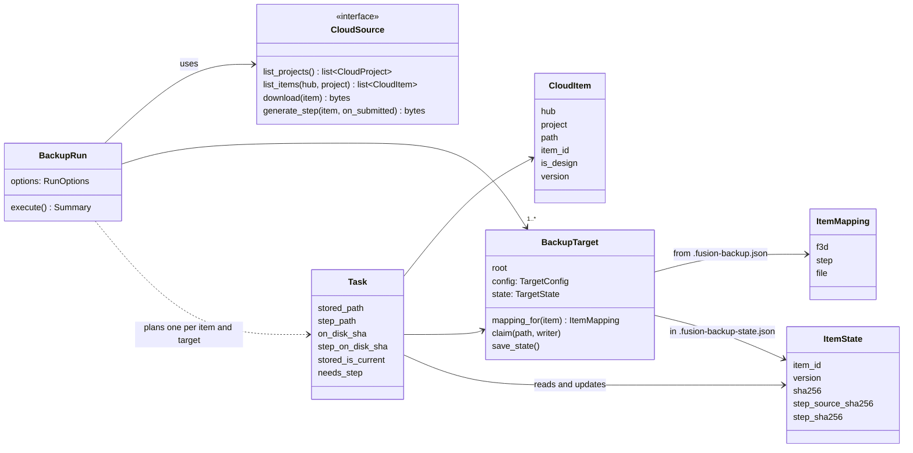
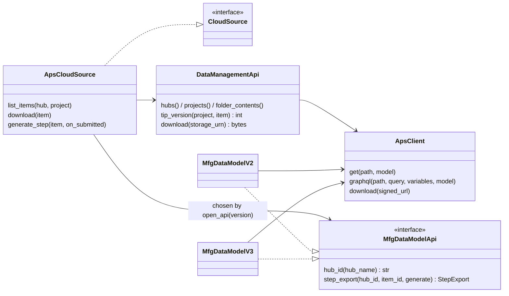
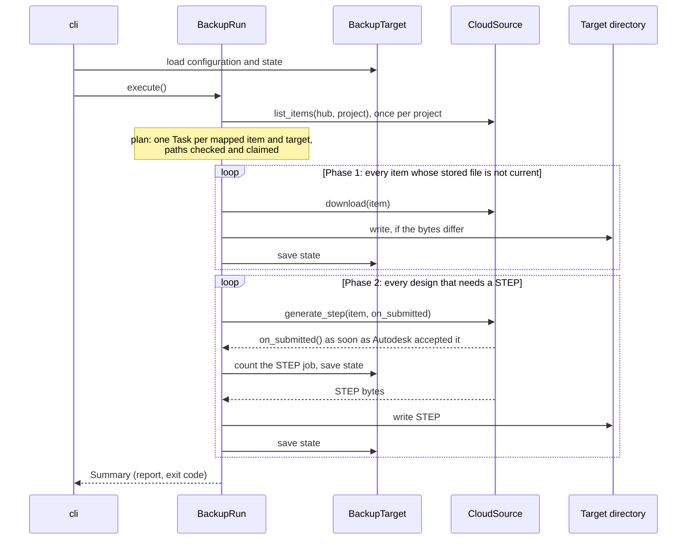
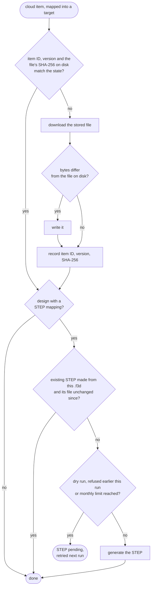
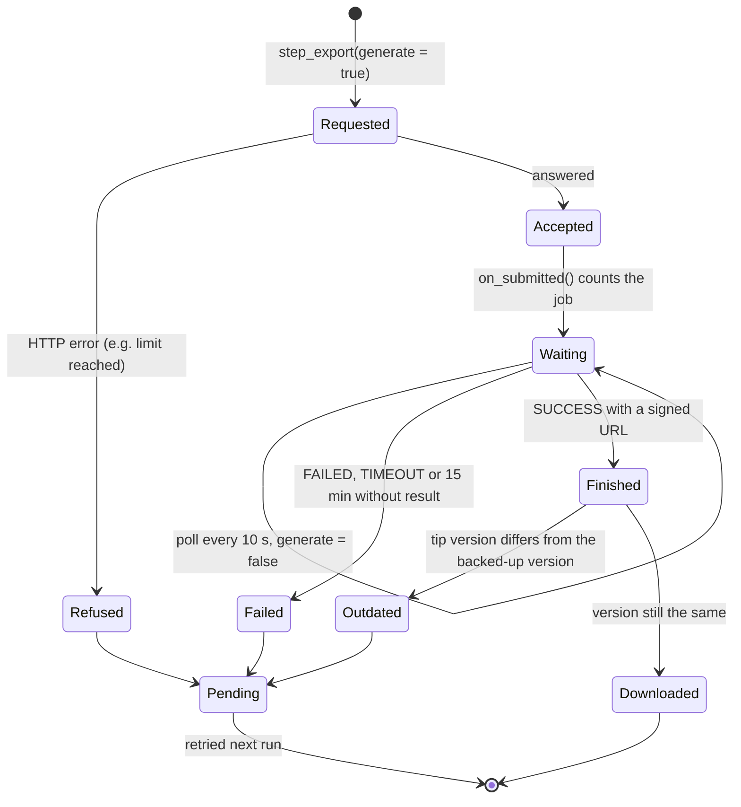
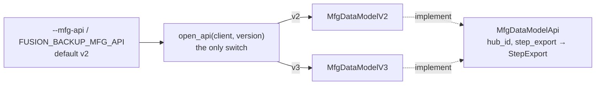

# Architecture

This document explains how fusion-backup is built and why, for developers who want to understand or change it without reading every file first. How to install, configure and run the tool is in the [README](../README.md); how the robot login is set up is in [authentication.md](authentication.md).

In one sentence: fusion-backup lists a Fusion project in the Autodesk cloud, downloads every design's `.f3d` (and every uploaded file) that changed since the last run, has Autodesk generate a STEP for every design whose `.f3d` changed, writes everything into a target directory and records what it holds in a state file there.

## Context

* Fusion itself never runs. Everything comes from Autodesk's web APIs ([Data Management](https://aps.autodesk.com/en/docs/data/v2/), including its [signed S3 downloads](https://aps.autodesk.com/en/docs/data/v2/reference/http/buckets-:bucketKey-objects-:objectKey-signeds3download-GET), and the Manufacturing Data Model API), so the tool runs headless on any machine with outgoing HTTPS to Autodesk.
* The tool logs in as a **robot user**, an APS [Secure Service Account (SSA)](https://aps.autodesk.com/en/docs/ssa/v1), that is a member of the Fusion hub with at least Reader access to the project (see [below](#the-robot-login)).
* The tool **never runs git**. It only writes files; committing and pushing is the caller's job, e.g. a step in the CI workflow. That keeps it independent of any CI system or git host.

## Layers

The code is one Python package with four parts. Their allowed dependencies are enforced by [import-linter](https://github.com/seddonym/import-linter) on every build:

* **`cloud`** is the contract: the domain objects (`CloudProject`, `CloudItem`), the `CloudSource` interface and its two errors. It knows nothing about Autodesk.
* **`backup`** contains all decisions (mapping, hashing, STEP rules, state, limits) and depends only on `cloud`. It can be tested completely against an in-memory `CloudSource`.
* **`aps`** implements `CloudSource` with Autodesk's APIs. Autodesk's response models (`aps._dto`) may not be imported from outside `aps`, so no Autodesk shape leaks into the backup logic.
* **`cli`** is the only place where the parts meet: it builds the robot login, the `ApsCloudSource` and the targets, and hands them to the run.

## Core types

### The backup side

* **`BackupTarget`** is one directory with its configuration (`.fusion-backup.json`, written by you) and its state (`.fusion-backup-state.json`, written by the tool). It answers where an item goes (an explicit mapping, the mirror default, ignored or unmapped) and guards the paths: they must stay inside the directory, may not point into `.git` or at the tool's own files, and no two writers may claim the same file, including names that differ only in upper and lower case.
* **`Task`** is one cloud item in one target. It knows the paths, the recorded state and the hashes of the files on disk, and decides whether the stored file is current and whether a STEP is needed.
* **`BackupRun`** executes the tasks in two phases and collects a **`Summary`**. A failing item is recorded and the run continues; only the summary's errors decide the exit code.

### The Autodesk side

* **`ApsClient`** is the thin HTTP layer over the logged-in client. It parses answers into Pydantic models and turns every transport, HTTP and login failure into a `CloudError`. Pre-signed URLs and Autodesk's raw answers never appear in those messages, because both can contain credentials.
* There is **one class per Autodesk API**, and for the Manufacturing Data Model API **one class per API version** (see [below](#two-versions-of-the-manufacturing-data-model-api)).
* **`ApsCloudSource`** combines them and is the only class that hands data to the backup, and only as `cloud` domain objects.

## A run

* **Downloads come first, STEP exports second.** Downloads are free; exports may be metered. A failed or refused export never prevents the `.f3d` from being backed up; the STEP just stays pending for the next run.
* **An item mapped into several targets** is downloaded and exported once and written into each of them.
* **The state is saved after every step**, so an interrupted run loses nothing that was already written, and a STEP job is counted even if the process dies while Autodesk is still working on it.

## When is something downloaded, written or exported?

The rules rest on two facts about Autodesk's files:

* **A version's stored `.f3d` is byte-stable**: downloading it twice gives the same bytes. So item ID plus version identify the content, and the SHA-256 of the file on disk proves the target still holds it. Local edits or a deleted file are therefore noticed and repaired. Timestamps are useless here, because a git checkout resets them.
* **STEP exports are not byte-stable** across generations: every export carries its own timestamp. A STEP is therefore never compared with a fresh export. Instead the state records which `.f3d` (by SHA-256) it was made from, plus the STEP file's own SHA-256, so a new STEP is requested only when its source changed or the file on disk was lost or altered.

The **item ID** is part of the state because a design that is deleted and re-created under the same name starts again at version 1; without the ID it would look unchanged.

## A STEP export

* **A job is counted the moment Autodesk accepts the request**, not when it succeeds, because that is when it may be metered. A refusal is not counted, and after one refusal the run requests no further STEPs.
* **Autodesk keeps one export per design version.** Requesting a STEP for a version that was already exported returns the existing file within seconds.
* **Before the finished STEP is downloaded, the Data Management API is asked for the design's current version.** If someone saved a new version meanwhile, the export may belong to that newer version, so it is discarded and retried next run instead of being stored next to an older `.f3d`.

## Two versions of the Manufacturing Data Model API

Autodesk runs [v2](https://aps.autodesk.com/en/docs/mfgdataapi/v2/) and [v3](https://aps.autodesk.com/en/docs/mfgdataapi/v3/developers_guide/) of the API side by side; what each costs and how to choose one is in the README's [How it works](../README.md#how-it-works). fusion-backup supports both behind one interface:

| | v2 | v3 |
|---|---|---|
| Endpoint | `/mfg/graphql` | `/mfg/v3/graphql/public` |
| Design's derivatives below | `tipRootComponentVersion` | `tipRootModel` |
| STEP requested with | `outputFormat: [STEP]` | `targetFormat: [STEP]` |
| Version number of the design | available | not exposed |

* Each version lives in its own module with its own endpoint, query and response models, and both implement `MfgDataModelApi` explicitly, so the type checker rejects an implementation with a missing method or a different signature.
* Hub and item IDs are the same in both versions, and both return the same cached export for a design version, so switching does not change any backed-up file.
* The version check before downloading a STEP uses the Data Management API, because v3 does not expose version numbers. That way both versions behave identically.

## The robot login

Why the tool logs in as a robot instead of a user login or app credentials, how the robot is created with Autodesk's SSA Manager and invited into the hub, and how its token exchange works is described in [authentication.md](authentication.md). In the code:

* `aps.auth.connect` builds Authlib's JWT bearer client ([RFC 7523](https://datatracker.ietf.org/doc/html/rfc7523)) with a joserfc RSA key; it requests a new access token whenever the current one expires. Each token request gets a fresh claims set, because Authlib stores the generated JWT ID in it.
* `SsaCredentials` reads the static credentials from the environment and keeps the secrets out of its `repr`, so they never end up in logs.
* Autodesk's usage API rejects robots ([limitations](authentication.md#limitations)), so the tool counts the STEP jobs it starts per month in the state file itself, and `--step-limit` stops at a limit you choose.

## Design decisions in short

| Decision | Why |
|---|---|
| Robot login (Secure Service Account) | Static credentials for unattended runs; the alternatives are compared in [authentication.md](authentication.md#why-a-robot) |
| The tool writes files but never runs git | Committing belongs to the workflow around it; the tool stays usable with any CI and any git host, or without git |
| State file next to the backed-up files | The target describes itself; committing it with the files keeps both consistent, and any machine can continue where the last run stopped |
| SHA-256 and item IDs instead of timestamps | Git checkouts reset timestamps; hashes prove content, IDs catch re-created designs |
| Downloads before exports, exports retried later | The free, essential part (the `.f3d`) never depends on the metered, optional part (the STEP) |
| One interface, one module per API version | Autodesk's API versions differ in endpoint and query shape only; the rest of the tool never notices which one runs |
| Errors never contain signed URLs or raw answers | Both can carry credentials, and errors end up in CI logs |
| Libraries for everything generic | [Typer](https://typer.tiangolo.com/) (command line), [httpx2](https://github.com/pydantic/httpx2) (HTTP), [Authlib](https://authlib.org/) with [joserfc](https://jose.authlib.org/) (JWT login), [Pydantic](https://docs.pydantic.dev/) (Autodesk answers, configuration and state); the tool's own code is only the backup logic and the Autodesk specifics |

## Tests

The layers above are also the test seams: the backup logic is tested against an in-memory `CloudSource`, the Autodesk layer against scripted HTTP answers. How, and what the end-to-end tests cover, is in [development.md](development.md#tests).
